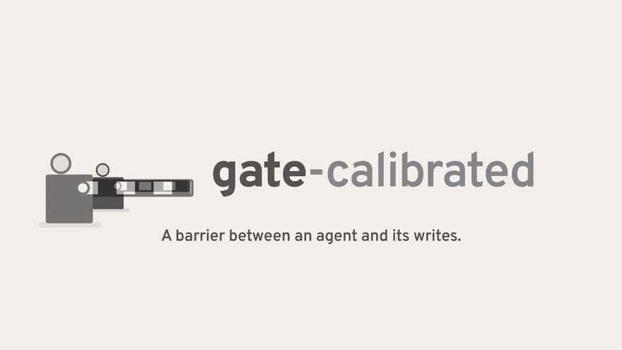

<p align="center">
  <picture>
    <source media="(prefers-color-scheme: dark)" srcset="assets/logo/logo-animated-dark.svg">
    
  </picture>
</p>

<p align="center">
  Before a tool-using agent executes a write, a barrier decides: let it through (act) or stop and ask a person (ask).
</p>

<p align="center">
  <a href="#main-result">Result</a> ·
  <a href="#use-the-gate-in-your-own-agent">Use it</a> ·
  <a href="#reproduce">Reproduce</a> ·
  <a href="#limitations">Limitations</a>
</p>

<p align="center">
  <a href="assets/video/gate-calibrated.mp4">
    
  </a>
  <br>
  <sub><a href="assets/video/gate-calibrated.mp4">Watch the 24-second film (MP4, 1.1 MB)</a>. Every id and number in it is a real row from this repo's data.</sub>
</p>

The gate decides from a calibrated success probability and a threshold set by conformal risk control. This repo is an open and reproducible implementation of ideas described in ToolChain-CRC (arXiv 2606.18467) and CORA (arXiv 2604.09155), evaluated on tau-bench retail, and it reports what the data showed, including where the approach did not help.

## Main result

The risk control held on the live test split in point estimates: every calibrated configuration kept the share of trajectories with an executed wrong write at or under its alpha (1.7% at alpha 0.02, 3.7% at 0.05, 3.0% at 0.10 and 0.20; 460 trajectories each). It did not beat the simple alternatives: at alpha 0.10 and above the calibrated gate never asks on a write step and is in practice the same policy as the fixed 0.7 threshold, and at alpha 0.02 it removes wrong writes at a rate per extra approval indistinguishable from confirming every write (0.058 against 0.062 wrong writes avoided per approval; difference CI [-0.04, 0.03]). The likely reason is the signal: glm-5.3-flash stated a confidence of 0.9 or more on all 43 wrong write steps in the collected data, so the calibrator's only useful feature was the position of the step in the conversation.

## What it does

Agents with tools sometimes execute write actions that are wrong: a wrong item id, a wrong payment method, a cancellation the user did not ask for. This gate sits between the agent and the environment. For every write-tier action it computes two confidence signals (the model's own probability estimate, and the agreement of k resampled next actions), maps them to a calibrated probability of success, and compares that probability to a threshold picked by conformal risk control. Actions in the irreversible tier (cancel, return, exchange) always ask, under every policy compared here.

Three policies, same agent model:

- `confirm_all`: asks on every write and irreversible action.
- `fixed_threshold`: asks when the raw verbalized probability is under 0.7.
- `calibrated`: asks when the calibrated probability is under a threshold lambda, where lambda is the smallest value whose conformal bound keeps the probability of a trajectory with an executed wrong write under alpha (alpha swept over 0.02, 0.05, 0.10, 0.20).

The headline measurement is a curve: wrong writes executed without approval per trajectory, against approvals requested per trajectory, on the tau-bench retail test split.

## Results

### Live evaluation

Test split, 115 tasks x 4 trials = 460 trajectories per configuration, agent and simulated user glm-5.3-flash, perfect oracle, regular z.ai API. Brackets are bootstrap 95% CIs over tasks. Full tables in `results/report.md`, plot in `results/curve.png`.

| policy | trajectories with an executed wrong write | wrong writes/traj | approvals/traj |
|---|---|---|---|
| confirm_all | 0.0% | 0.000 | 1.57 [1.38, 1.77] |
| fixed_threshold | 4.6% [1.7%, 7.8%] | 0.048 | 0.95 [0.78, 1.15] |
| calibrated, alpha 0.02 (lambda 0.960) | 1.7% [0.2%, 3.7%] | 0.017 | 1.32 [1.13, 1.50] |
| calibrated, alpha 0.05 (lambda 0.914) | 3.7% [1.5%, 6.1%] | 0.037 | 0.97 [0.79, 1.15] |
| calibrated, alpha 0.10 and 0.20 (lambda 0.668) | 3.0% [0.9%, 5.9%] | 0.030 | 0.92 [0.75, 1.11] |


How to read it:

- `fixed_threshold` and calibrated at lambda 0.668 ask on irreversible actions only. Over the 549 write steps collected in Phase 2, the fixed threshold would ask on 1 (a parse fallback of 0.5) and the calibrated one on none (the lowest calibrated write probability is 0.79). Their gap (4.6% against 3.0%, and pass^4 0.826 against 0.852 below) is the size of the noise between two equivalent policies at 460 trajectories, not an effect.
- Calibrated at lambda 0.914 asks on few write steps (29 of 271 on the cal block) and lands inside the same noise band.
- Calibrated at lambda 0.960 is the only calibrated configuration that changes behavior on writes: on the cal block it would ask on 41% of write steps (111 of 271) and catch 22 of 31 wrong ones (asking at random on 41% would catch about 13). Live, against the pooled irreversible-only policies, it trades 0.38 extra approvals per trajectory for 0.022 fewer wrong writes per trajectory; confirm_all trades 0.63 extra approvals for 0.039 fewer. Per approval the two are indistinguishable at this sample size (0.058 against 0.062, difference CI [-0.04, 0.03] by task bootstrap); the comparison also depends on which equivalent policy is the baseline (against fixed_threshold alone 0.084 against 0.077, against the lambda 0.668 run alone 0.033 against 0.047).
- conformal risk control bounds the expected loss, not each sample: at alpha 0.02 the point estimate is 1.7% and the upper CI reaches 3.7%.
- confirm_all removes executed wrong writes completely (0 of 460), as the plan's Phase 6 check requires.

Task success (pass^k, unbiased estimator: probability that k independent trials of a task all succeed):

| policy | pass^1 | pass^4 |
|---|---|---|
| confirm_all | 0.909 | 0.835 |
| fixed_threshold | 0.893 | 0.826 |
| calibrated, alpha 0.02 | 0.891 | 0.817 |
| calibrated, alpha 0.05 | 0.883 | 0.783 |
| calibrated, alpha 0.10 and 0.20 | 0.906 | 0.852 |

Most gaps here are within noise: the two equivalent policies differ by 0.013 on pass^1 and 0.026 on pass^4, and confirm_all differs by 0.018 on pass^1 between the two endpoints (`results/report_coding_plan.md`). One gap is larger: calibrated at alpha 0.05 is 0.070 below the lambda 0.668 run on pass^4 (paired task bootstrap CI [-0.130, -0.017], not corrected for the roughly ten comparisons in this table). Since that policy differs from the lambda 0.668 one on only about 11% of write steps, this is more likely noise than an effect of asking, but the data cannot rule an effect out.

### Signals and calibration

Phase 2 collected 1040 ungated trajectories on 520 train and dev tasks: 1535 gated steps (549 write, 986 irreversible), 6.3% of them wrong. On the cal block (780 gated steps, 6.8% wrong), fit on the fit block:

| variant | ECE | Brier |
|---|---|---|
| raw verbalized | 0.0659 | 0.0675 |
| A: temperature scaling | 0.0531 | 0.0678 |
| B: logistic regression | 0.0502 | 0.0647 |

Both signals are saturated. Verbalized confidence is 0.9 or more on 548 of 549 write steps, including all 43 wrong ones. Self-agreement (k=5, temperature 0.7) is 0.9 or more on 758 of 780 cal steps. Calibration lowers ECE mostly by moving a near-constant prediction to the base rate. The logistic regression (variant B, used live) puts weight 0.03 on the logit of verbalized confidence, 0.12 on agreement, -0.41 on the irreversible tier and -0.80 on log(1 + step index), all on standardized features: later steps are riskier, and that position is what ranks the steps.

The thresholds from conformal risk control on the cal trajectories: lambda 0.960 at alpha 0.02, 0.914 at 0.05, 0.668 at both 0.10 and 0.20 (at 0.668 the bound is already met without asking on any write step, so the two alphas share one run).

Base rates on historical tau-bench retail trajectories (test split, labeled with the same canonical comparison): gpt-4o executed 199 wrong gated actions out of 666 (29.9%), sonnet-3.5 284 of 1352 (21.0%). glm-5.3 as agent erred on only 4% of gated actions in a 20-task pilot, too few positives to fit a calibrator, which is why the agent here is glm-5.3-flash.

## Use the gate in your own agent

The decision is one LangGraph node. When the policy says ask, `gate_node` pauses the graph with `interrupt()` and your reviewer resumes it with `Command(resume={"approved": ...})`. The example below loads the calibrator and threshold this repo fitted, and gates the write the film shows being stopped (step 22, stated confidence 1.00):

```python
import dataclasses, json, uuid
from langgraph.checkpoint.memory import MemorySaver
from langgraph.graph import END, START, StateGraph
from langgraph.types import Command

from gate.calibrator import calibrator_from_json
from gate.middleware import GateGraphState, gate_node
from gate.types import StepRecord

cal = json.load(open("results/calibration.json"))
calibrator = calibrator_from_json(cal["calibrator"])
lam = cal["lambda_table"]["0.02"]  # threshold for alpha = 0.02

# a write the agent proposes, with its two signals
record = StepRecord(task_id=0, split="live", trial=0, step_index=22,
                    tool_name="modify_pending_order_items",
                    kwargs={"order_id": "#W7398274"}, tier="write",
                    verbalized=1.0, agreement=1.0)
record.p_hat = float(calibrator.predict_proba([dataclasses.asdict(record)])[0])

builder = StateGraph(GateGraphState)
builder.add_node("gate", gate_node)
builder.add_edge(START, "gate")
builder.add_edge("gate", END)
graph = builder.compile(checkpointer=MemorySaver())

config = {"configurable": {"thread_id": uuid.uuid4().hex}}
out = graph.invoke({"record": dataclasses.asdict(record),
                    "policy_name": "calibrated", "lam": lam}, config)
if "__interrupt__" in out:  # p_hat < lambda: the gate asks
    print(out["__interrupt__"][0].value["gate_reason"])
    out = graph.invoke(Command(resume={"approved": False}), config)
print(out["action"], out["approved"])
```

It prints `p_hat=0.866... < lambda=0.960...` and then `ask False`. Put the node between your agent step and your tool-execution node, and route on `approved`. For tau-bench itself, `TauGateAgent` in `gate/middleware.py` wraps the agent loop with the same policy and a reviewer; `examples/minimal_gate_graph.py` is a two-node graph you can run as is.

To gate a different agent you need the two signals per proposed write (`gate/signals.py` computes both with any litellm model) and, ideally, a calibrator and threshold fitted on your own trajectories (`python -m eval.fit`). The fitted values here are specific to glm-5.3-flash on tau-bench retail.

## Reproduce

```bash
python -m venv .venv && .venv/Scripts/activate  # or source .venv/bin/activate
pip install -e ".[dev]"
# Windows: set PYTHONUTF8=1 before installing; tau-bench's setup.py reads
# its README without an encoding.
pytest

# 1. collect trajectories with signals (fit + cal blocks, 520 tasks x 2 trials)
python -m eval.collect --split all --trials 2 --concurrency 8

# 2. verify labels, fit calibrators, compute the lambda table
python -m eval.fit

# 3. live policy comparison on the test split
python -m eval.run_policies --policy confirm_all --trials 4 --concurrency 4
python -m eval.run_policies --policy fixed_threshold --trials 4 --concurrency 4
python -m eval.run_policies --policy calibrated --trials 4 --concurrency 4

# 4. report (one command, from cached traces)
python -m eval.report
```

Models and endpoint come from environment variables (`GATE_AGENT_MODEL`, `GATE_USER_MODEL`, `GATE_MODEL_PROVIDER`); keys are never written to a file. The runs here used two z.ai endpoints:

```bash
# Phase 2 collection (Anthropic-compatible endpoint, the default provider)
export ANTHROPIC_BASE_URL=https://api.z.ai/api/anthropic ANTHROPIC_AUTH_TOKEN=<z.ai key>
# Phase 6 main run (regular OpenAI-compatible API)
export GATE_MODEL_PROVIDER=openai OPENAI_API_BASE=https://api.z.ai/api/paas/v4 OPENAI_API_KEY=<z.ai key>
```

Every Phase 6 row records its endpoint, and resume is per endpoint. Step 4 reads only `results/policies/rows.jsonl` and `results/calibration.json` and makes no model calls. Temperature-0 calls in steps 1 to 3 are cached on disk under `.cache/llm`; note that temperature 0 is not deterministic on this endpoint (a repeat of 30 next-action calls matched on 14), so the cache, not a rerun, is what reproduces a given trace. Each run writes JSONL rows with its full config and a manifest with token and USD accounting.

The LangGraph integration is `gate_node` in `gate/middleware.py`, with a runnable example in `examples/minimal_gate_graph.py` that pauses with `interrupt()` and resumes with `Command(resume=...)`.

## Repository layout

| path | what it holds |
|---|---|
| `gate/tiers.py`, `gate/labeling.py` | which tools are gated, and the canonical comparison against gold actions |
| `gate/signals.py` | verbalized confidence and k-sample agreement |
| `gate/calibrator.py`, `gate/threshold.py` | temperature scaling and logistic regression; conformal risk control for lambda |
| `gate/policy.py`, `gate/oracle.py`, `gate/middleware.py` | the three policies, the simulated reviewer, the gated agent loop and the LangGraph node |
| `gate/llm.py` | the single model-call wrapper: disk cache, token and USD accounting, rate-limit backoff |
| `eval/` | collection, fitting, live policy runs, metrics, report |
| `results/` | every number in this README, plus the run manifests |
| `notes/` | phase notes, environment check, decision drafts, and a log of real mistakes the AI made while building this |
| `assets/` | logo (generated by `assets/logo/build_logo.py`), fonts, the film |
| `brag-output/` | the HyperFrames source of the film |

## Cost

USD at z.ai list prices of 2026-10-13 (glm-5.3-flash $0.15 / $0.50 per million input / output tokens), computed from the token counts in the run manifests. Runs on the coding-plan endpoint were billed as a flat-rate subscription, so their figures are list-price equivalents, not money spent.

| run | endpoint | trajectories | cost |
|---|---|---|---|
| Phase 2 collection (signals on every gated step) | coding plan | 1040 | $8.36 measured for 1009; about $8.6 for all 1040, extrapolated (the initial 31 have no usage record) |
| Phase 6, all five configurations | regular API | 2300 | $57.16 measured for 2158; 142 more come from five processes stopped when the account balance ran out, with no usage record (about $3 to $4 at the same rate) |
| Phase 6 partial run (confirm_all 460, fixed_threshold 369, calibrated 250) | coding plan | 1179 | flat rate; reported separately in `results/report_coding_plan.md` |

The calibrated configurations cost more than confirm_all ($6.67 measured for 408 confirm_all trajectories) because they compute the signals on every gated step, and agreement sampling at temperature 0.7 is never cached.

## Limitations

- The human is a perfect oracle built from the gold actions of tau-bench. A real reviewer errs and tires.
- tau-bench retail is one domain with one policy; generalization is not evaluated.
- The user is simulated by a model (glm-5.3-flash).
- The risk guarantee assumes exchangeability between calibration and test trajectories and is computed on ungated runs; under the gate, a rejection changes the path the agent takes afterwards. The live evaluation measures the actual effect.
- Labeling compares against gold actions: an action that is valid but different from gold counts as wrong.
- Verbalized confidence and self-agreement are saturated for glm-5.3-flash (and, in a 20-task pilot, for glm-5.3). With these signals the gate cannot separate right from wrong writes by confidence; a model or signal with real spread could change the outcome, and that is not tested here.
- Irreversible actions always ask under every policy, and they are most gated steps (986 of 1535 collected), so most approvals are the same across policies and the policies differ only on write-tier steps.
- The calibrator was fit on ungated trajectories from the train and dev splits, collected on the Anthropic-compatible z.ai endpoint; the live run used the regular z.ai API. A temperature-0 check on 30 real conversation prefixes found cross-endpoint agreement (18 and 15 of 30) within same-endpoint repeat agreement (14 of 30), and confirm_all had 0 executed wrong writes on both endpoints (pass^1 0.909 against 0.891), but this is not a proof of identical serving.
- Results are for one agent model and one set of seeds.

## Credits

tau-bench is by Sierra Research (MIT), pinned here to commit 59a200c. The gate design follows ideas described in ToolChain-CRC (arXiv 2606.18467) and CORA (arXiv 2604.09155). This repository is an independent implementation and evaluation; the papers' authors are not involved.

Logo and film: wordmark set in Overpass (SIL Open Font License), sound effects by Kenney (CC0), film built with HyperFrames. The film has no music because the license of the bundled tracks was not verified for redistribution.

License: MIT (see LICENSE).
