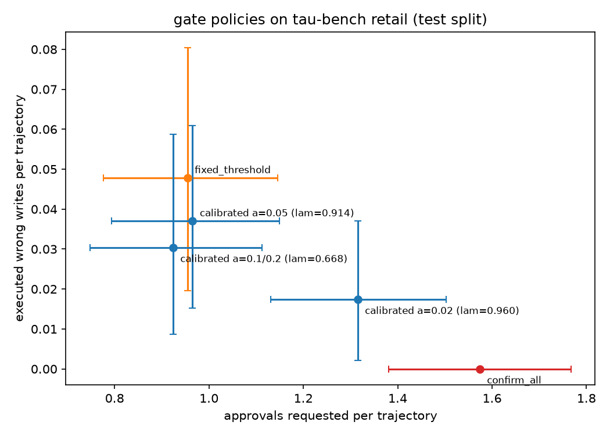

# gate-calibrated results

Endpoint: regular z.ai API (OpenAI-compatible, api/paas/v4). Agent and simulated user: glm-5.3-flash. Oracle: perfect (gold actions). Test split, 115 tasks x 4 trials per configuration where complete. Full configs in the run manifests.

## Headline: wrong writes executed vs approvals requested

Bootstrap 95% CIs resample tasks. The calibrated rows target P(trajectory has >= 1 executed wrong write) <= alpha.

| policy | n | wrong writes/traj (95% CI) | trajs with >=1 wrong write (95% CI) | approvals/traj (95% CI) | rejections/traj |
|---|---|---|---|---|---|
| confirm_all | 460 | 0.000 [0.000, 0.000] | 0.0% [0.0%, 0.0%] | 1.57 [1.38, 1.77] | 0.17 |
| fixed_threshold | 460 | 0.048 [0.020, 0.080] | 4.6% [1.7%, 7.8%] | 0.95 [0.78, 1.15] | 0.13 |
| calibrated a=0.02 (lam=0.960) | 460 | 0.017 [0.002, 0.037] | 1.7% [0.2%, 3.7%] | 1.32 [1.13, 1.50] | 0.18 |
| calibrated a=0.05 (lam=0.914) | 460 | 0.037 [0.015, 0.061] | 3.7% [1.5%, 6.1%] | 0.97 [0.79, 1.15] | 0.12 |
| calibrated a=0.1/0.2 (lam=0.668) | 460 | 0.030 [0.009, 0.059] | 3.0% [0.9%, 5.9%] | 0.92 [0.75, 1.11] | 0.12 |

## pass^k (unbiased estimator)

| policy | pass^1 | pass^2 | pass^3 | pass^4 | mean reward |
|---|---|---|---|---|---|
| confirm_all | 0.909 | 0.870 | 0.848 | 0.835 | 0.909 |
| fixed_threshold | 0.893 | 0.855 | 0.837 | 0.826 | 0.893 |
| calibrated a=0.02 (lam=0.960) | 0.891 | 0.855 | 0.833 | 0.817 | 0.891 |
| calibrated a=0.05 (lam=0.914) | 0.883 | 0.830 | 0.800 | 0.783 | 0.883 |
| calibrated a=0.1/0.2 (lam=0.668) | 0.906 | 0.878 | 0.863 | 0.852 | 0.906 |

## Calibration (cal block, fit on the fit block)

| variant | ECE | Brier |
|---|---|---|
| raw | 0.0659 | 0.0675 |
| A_temperature_scaling | 0.0531 | 0.0678 |
| B_logistic_regression | 0.0502 | 0.0647 |

Chosen for the live run: B_logistic_regression (lowest Brier on cal).

| alpha | lambda | expected approvals/traj (cal) |
|---|---|---|
| 0.02 | 0.9603 | 1.16 |
| 0.05 | 0.9136 | 1.01 |
| 0.1 | 0.6678 | 0.95 |
| 0.2 | 0.6678 | 0.95 |

## Endpoint check: configurations run in full on both endpoints

| policy | endpoint | wrong writes/traj | approvals/traj | pass^1 | pass^4 |
|---|---|---|---|---|---|
| confirm_all | regular | 0.000 | 1.57 [1.38, 1.77] | 0.909 | 0.835 |
| confirm_all | coding plan | 0.000 | 1.61 [1.42, 1.80] | 0.891 | 0.809 |
