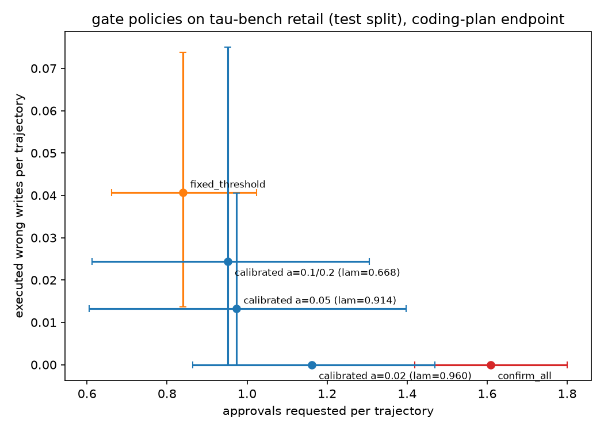

# gate-calibrated results (coding plan)

Endpoint: z.ai coding-plan endpoint (Anthropic-compatible). Agent and simulated user: glm-5.3-flash. Oracle: perfect (gold actions). Test split, 115 tasks x 4 trials per configuration where complete. Full configs in the run manifests.

## Headline: wrong writes executed vs approvals requested

Bootstrap 95% CIs resample tasks. The calibrated rows target P(trajectory has >= 1 executed wrong write) <= alpha.

| policy | n | wrong writes/traj (95% CI) | trajs with >=1 wrong write (95% CI) | approvals/traj (95% CI) | rejections/traj |
|---|---|---|---|---|---|
| confirm_all | 460 | 0.000 [0.000, 0.000] | 0.0% [0.0%, 0.0%] | 1.61 [1.42, 1.80] | 0.22 |
| fixed_threshold | 369 | 0.041 [0.014, 0.074] | 4.1% [1.4%, 7.4%] | 0.84 [0.66, 1.02] | 0.05 |
| calibrated a=0.02 (lam=0.960) | 93 | 0.000 [0.000, 0.000] | 0.0% [0.0%, 0.0%] | 1.16 [0.86, 1.47] | 0.11 |
| calibrated a=0.05 (lam=0.914) | 75 | 0.013 [0.000, 0.041] | 1.3% [0.0%, 4.0%] | 0.97 [0.61, 1.40] | 0.15 |
| calibrated a=0.1/0.2 (lam=0.668) | 82 | 0.024 [0.000, 0.075] | 2.4% [0.0%, 7.5%] | 0.95 [0.61, 1.30] | 0.15 |

## pass^k (unbiased estimator)

| policy | pass^1 | pass^2 | pass^3 | pass^4 | mean reward |
|---|---|---|---|---|---|
| confirm_all | 0.891 | 0.849 | 0.824 | 0.809 | 0.891 |
| fixed_threshold | 0.911 | 0.857 | 0.836 | 0.828 | 0.911 |
| calibrated a=0.02 (lam=0.960) | 0.948 | 0.896 | 0.885 | 0.875 | 0.946 |
| calibrated a=0.05 (lam=0.914) | 0.908 | 0.868 | 0.829 | 0.789 | 0.920 |
| calibrated a=0.1/0.2 (lam=0.668) | 0.905 | 0.865 | 0.786 | 0.762 | 0.902 |

## Calibration (cal block, fit on the fit block)

| variant | ECE | Brier |
|---|---|---|
| raw | 0.0659 | 0.0675 |
| A_temperature_scaling | 0.0531 | 0.0678 |
| B_logistic_regression | 0.0502 | 0.0647 |

Chosen for the live run: B_logistic_regression (lowest Brier on cal).

| alpha | lambda | expected approvals/traj (cal) |
|---|---|---|
| 0.02 | 0.9603 | 1.16 |
| 0.05 | 0.9136 | 1.01 |
| 0.1 | 0.6678 | 0.95 |
| 0.2 | 0.6678 | 0.95 |
